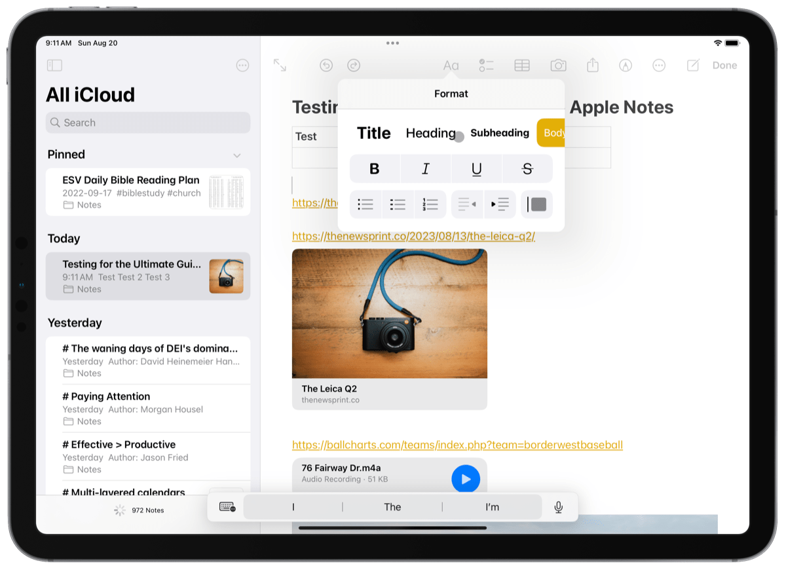

# Notes for Debian

An Apple Notes–style notes app for Debian and other GTK desktops: three panes (folders, note list, editor),
a rich editor with checklists and tables, locked notes, gallery view, and light/dark appearance.



## Install

```sh
packaging/build-deb.sh
sudo apt install ./dist/debian-notes_0.1.0_all.deb
```

Then launch **Notes** from the app grid, or run `debian-notes`.
Dependencies (`python3-gi`, `gir1.2-gtk-3.0`, `gir1.2-webkit2-4.1`) are pulled in by apt;
`fonts-inter` is recommended for the closest match to Apple's San Francisco typeface.

## Run from source

```sh
bin/debian-notes
```

Useful environment variables while developing:

| Variable | Effect |
| --- | --- |
| `NOTES_DATA_DIR=/tmp/x` | Use a separate database (also allows a second instance) |
| `NOTES_DEBUG=1` | Web inspector in the context menu, console output on stdout |
| `NOTES_THEME=light\|dark` | Override the system appearance |
| `NOTES_SNAPSHOT=out.png` | Render the window to a PNG and quit (with `NOTES_EVAL` to run JS first) |

Tests: `python3 -m unittest discover -s tests`

## Features

- Folders and nested subfolders (drag to nest), *All on My Computer*, *Recently Deleted* (kept 30 days)
- Notes grouped by Pinned / Today / Yesterday / Previous 7 Days / Previous 30 Days / month / year
- List and gallery views, sort by date edited, date created or title
- Editor: Title, Heading, Subheading, Body, Monostyled; bold, italic, underline, strikethrough, text colours;
  bulleted, dashed and numbered lists; checklists; block quotes; indentation; tables; images, file attachments
  and sketches; automatic links; `* `, `- `, `1. ` and `[] ` start lists as you type
- Optional slash commands: type `/` to turn a line into a title, list, checklist, table and more (Settings → Slash commands, off by default)
- `#hashtags` become tags in the sidebar
- Search across all notes, with matches highlighted in the list and the note
- Password-locked notes (encrypted at rest), pin notes, duplicate, move, drag notes onto folders
- Select several notes with Ctrl+A, Ctrl+click or Shift+click, then delete or move them together; Shift+click or Ctrl+click
  folders in the sidebar to see their notes together, delete them or drag them into another folder
- Ctrl+Z / Ctrl+Shift+Z (outside the editor) undo and redo moving, pinning, deleting, recovering and duplicating notes
- Export to PDF (print), HTML, Markdown and plain text; import `.txt`, `.md` and `.html`
- **iCloud and Local**: a switch at the top left. The app opens on **iCloud**: iCloud Notes on the web, inside the
  window and signed in with the app's own session (sign in once; only Apple's session token is stored, in
  `~/.local/share/debian-notes/icloud-web/`, private to your user). **Local** is this app with only the notes made on
  this computer: sidebar, folders, tags, list and editor, no iCloud notes and nothing sent to or pulled from iCloud.
- **Version history** for every note (Version History… in the note menu): snapshots while editing (at most every
  10 minutes), with preview and restore. Locked notes and iCloud notes keep none.
- Translucent sidebar (Settings), like macOS vibrancy.
- Light and dark appearance following the system, adjustable text size, keyboard shortcuts for everything

Data lives in `~/.local/share/debian-notes/` (`notes.db` plus an `attachments/` folder).

See [docs/ARCHITECTURE.md](docs/ARCHITECTURE.md) for how it fits together.
