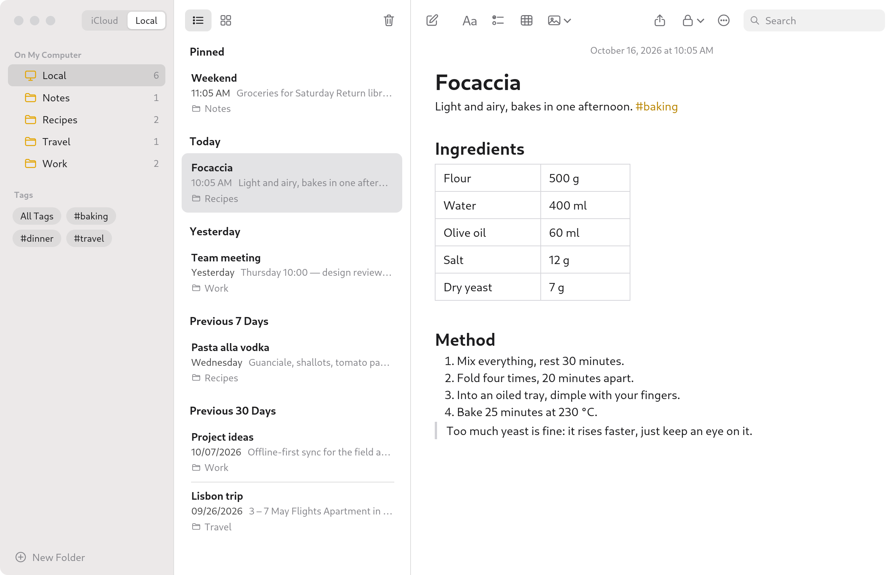
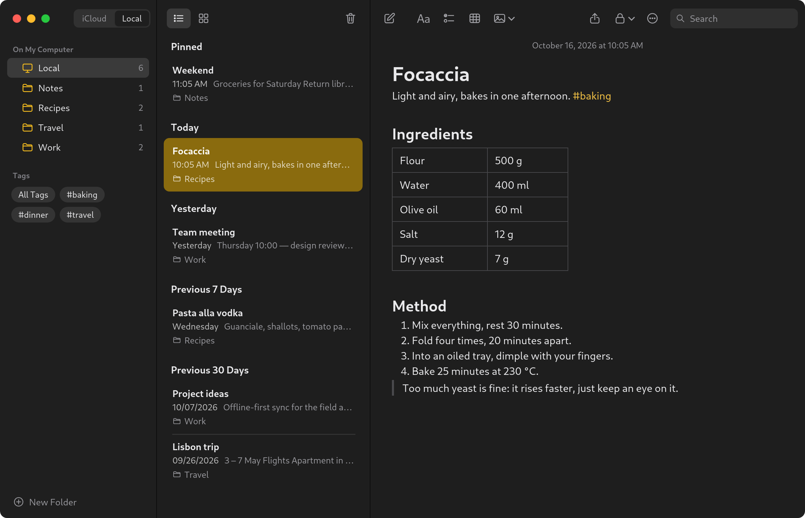

<div align="center">



# Notes for Debian

**A fast, private notes app for Debian and other GTK desktops, in the style of Apple Notes,
with your iCloud notes right next to your local ones.**



</div>

## Why

Apple Notes has no Linux app. Notes for Debian gives you the same calm, three-pane way of writing on your
Debian desktop, keeps your own notes on your own computer, and opens your iCloud notes in the same window when
you need them.

## Features

**Writing**

- Title, Heading, Subheading, Body and Monostyled text; bold, italic, underline, strikethrough and colours
- Bulleted, dashed and numbered lists, checklists, block quotes and indentation:
  `* `, `- `, `1. ` and `[] ` start a list as you type
- Tables with rows and columns you add, remove and Tab through
- Images, file attachments and sketches; drag and drop or paste them in
- Optional slash commands: type `/` to turn a line into a title, list, checklist, table and more

**Organising**

- Folders and subfolders, *Recently Deleted* (kept for 30 days) and pinned notes
- `#hashtags` become tags in the sidebar
- Notes grouped by Today, Yesterday, Previous 7 Days and so on, in a list or a gallery
- Search across every note, with matches highlighted in the list and in the note
- Select several notes (<kbd>Ctrl</kbd>+<kbd>A</kbd>, <kbd>Ctrl</kbd>/<kbd>Shift</kbd>+click) or folders and
  delete or move them together
- Undo and redo moving, pinning, deleting and duplicating notes with <kbd>Ctrl</kbd>+<kbd>Z</kbd>

**Keeping notes safe**

- Password-locked notes, encrypted at rest
- Version history for every note, with preview and restore
- Export to PDF, HTML, Markdown or plain text; import `.txt`, `.md` and `.html`

**Looks at home**

- Light and dark appearance that follows your system
- Translucent sidebar, adjustable text size and keyboard shortcuts for everything

<div align="center">



</div>

## iCloud and Local

A switch at the top left (or <kbd>Ctrl</kbd>+<kbd>←</kbd> / <kbd>Ctrl</kbd>+<kbd>→</kbd>, or <kbd>Ctrl</kbd>+<kbd>Tab</kbd>) moves between two places:

- **iCloud**: your iCloud notes, in iCloud Notes on the web, shown inside the app
  window. You sign in once on Apple's own sign-in page; after that the app opens straight into your notes.
  Everything you change there is saved to iCloud by Apple and shows up on your iPhone, iPad and Mac.
- **Local**: notes that live only on this computer: folders, tags, the full editor, and nothing sent anywhere.

Notes opens where you left it. Until you've signed in to iCloud, it opens on Local. Only need one of the two? Turn the other
off in Settings and the switch disappears.

**Background mode** (Settings): closing the window only hides it, and Notes starts hidden when you log in, so
iCloud opens instantly. While hidden it uses about 650 MB of memory and almost no processor time.
Quit for real with <kbd>Ctrl</kbd>+<kbd>Q</kbd> or ⋯ → *Quit Notes*.

> [!NOTE]
> With **Advanced Data Protection** turned on, iCloud.com can't open your notes until you allow it: on your
> iPhone go to *Settings → [your name] → iCloud* and turn on **Access iCloud Data on the Web**.

## Install

Notes for Debian runs on Debian 12 and newer (and other distributions with GTK 3 and WebKitGTK 4.1).

**As a package**

```sh
git clone https://github.com/claeslander/debian-notes.git
cd debian-notes
packaging/build-deb.sh
sudo apt install ./dist/debian-notes_0.1.0_all.deb
```

Then open **Notes** from your app grid, or run `debian-notes`. Its dependencies (`python3-gi`,
`gir1.2-gtk-3.0`, `gir1.2-webkit2-4.1`) come along with apt. Install `fonts-inter` for the closest look to
Apple's typeface.

**From the source tree, without installing**

```sh
bin/debian-notes                  # run it
packaging/install-local.sh        # add it to your app grid (--uninstall to remove)
```

## Keyboard shortcuts

| Action | Shortcut |
| --- | --- |
| New note / new folder | <kbd>Ctrl</kbd>+<kbd>N</kbd> / <kbd>Ctrl</kbd>+<kbd>Shift</kbd>+<kbd>N</kbd> |
| Search | <kbd>Ctrl</kbd>+<kbd>F</kbd> |
| iCloud / Local | <kbd>Ctrl</kbd>+<kbd>←</kbd> / <kbd>Ctrl</kbd>+<kbd>→</kbd>, or <kbd>Ctrl</kbd>+<kbd>Tab</kbd> |
| Title / Heading / Subheading / Body | <kbd>Ctrl</kbd>+<kbd>Shift</kbd>+<kbd>T</kbd> / <kbd>H</kbd> / <kbd>J</kbd> / <kbd>B</kbd> |
| Checklist / mark as checked | <kbd>Ctrl</kbd>+<kbd>Shift</kbd>+<kbd>L</kbd> / <kbd>Ctrl</kbd>+<kbd>Shift</kbd>+<kbd>U</kbd> |
| Table | <kbd>Ctrl</kbd>+<kbd>Alt</kbd>+<kbd>T</kbd> |
| Lock note | <kbd>Ctrl</kbd>+<kbd>L</kbd> |
| Select all notes | <kbd>Ctrl</kbd>+<kbd>A</kbd> (in the note list) |
| Undo / redo (notes) | <kbd>Ctrl</kbd>+<kbd>Z</kbd> / <kbd>Ctrl</kbd>+<kbd>Shift</kbd>+<kbd>Z</kbd> |
| List / gallery view | <kbd>Ctrl</kbd>+<kbd>1</kbd> / <kbd>Ctrl</kbd>+<kbd>2</kbd> |
| Quit | <kbd>Ctrl</kbd>+<kbd>Q</kbd> |

The full list is under ⋯ → *Keyboard Shortcuts*.

## Privacy

- Local notes are stored only on your computer, in `~/.local/share/debian-notes/` (`notes.db` and an
  `attachments/` folder). There is no account, no telemetry and no server of ours.
- Locked notes are encrypted with your password; it is never stored.
- For iCloud, your password goes straight to Apple's sign-in page. The app keeps only Apple's session cookies,
  in a folder that only your user can read (`~/.local/share/debian-notes/icloud-web/`).

## Development

```sh
python3 -m unittest discover -s tests     # run the tests
```

| Variable | Effect |
| --- | --- |
| `NOTES_DATA_DIR=/tmp/x` | Use a separate data folder (also allows a second instance) |
| `NOTES_DEBUG=1` | Web inspector in the context menu, console output on stdout |
| `NOTES_THEME=light\|dark` | Override the system appearance |
| `NOTES_SNAPSHOT=out.png` | Render the window to a PNG and quit (with `NOTES_EVAL` to run JavaScript first) |

The interface is HTML, CSS and JavaScript in a WebKitGTK view; Python handles the window, storage (SQLite) and
encryption. See [docs/ARCHITECTURE.md](docs/ARCHITECTURE.md) for how it fits together.

## License

[MIT](LICENSE) © 2026 Lander Claes

Notes for Debian is an independent project. It is not made by, affiliated with or endorsed by Apple Inc.
Apple, iCloud and Apple Notes are trademarks of Apple Inc.
