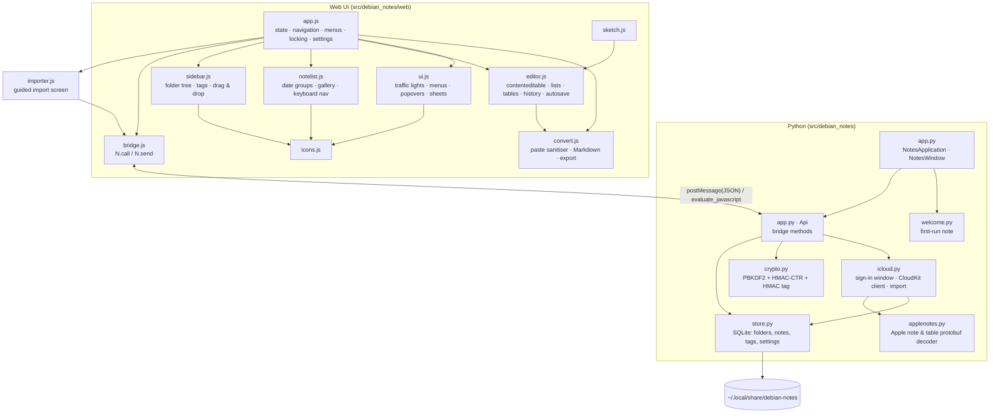

# Architecture

The app is a GTK 3 window hosting a single WebKitGTK view. Everything you see is HTML/CSS
(that is what makes a faithful macOS look possible on Linux); everything that touches the
disk, the window or the system lives in Python. They talk over a small JSON bridge.

## Component graph

## Key decisions

| Decision | Why |
| --- | --- |
| GTK 3 + WebKit2 4.1 | Installed by default on Debian 13 GNOME; WebKit 6 / GTK 4 would add a dependency for no visible gain. |
| Client-side window, HTML traffic lights | The Apple look needs the toolbar to *be* the title bar. Python handles drag/double-click on the toolbar regions JS reports (`setDragRegions`), so moving the window feels native. |
| Own list/table/blockquote DOM code | WebKit's `insertUnorderedList` merges neighbouring lists and wraps them in `
`s. |
| Own undo history | Manual DOM edits would corrupt WebKit's native undo stack; snapshots with path-based selection restore exactly. |
| Note HTML stored as-is, plus `plain`, `title`, `snippet` | The list renders without loading bodies; search runs in SQL. |
| Attachments as files, referenced by `file://` URI | Keeps the database small; HTML export inlines them as data URIs. |
| iCloud import through a sign-in window | The user signs in on Apple's page in a separate WebKit profile (`icloud-web/`); Python reuses its cookies to call the CloudKit web service iCloud.com uses, then decodes Apple's protobuf note format itself. No password is handled by the app. |
| Locking in Python with the stdlib | No crypto dependency and no reliance on WebCrypto in a `file://` page. Keys live only in memory while unlocked. |

## Data model

- `folders(id, name, parent_id, is_default)`; the default folder "Notes" can't be renamed or deleted.
- `notes(id, folder_id, title, snippet, body, plain, thumbnail, created_at, updated_at, pinned, locked, locked_payload, deleted_at)`.
  Locked notes keep only their title in clear text; `body`/`plain` are emptied and the HTML lives encrypted in `locked_payload`.
- `note_tags(note_id, tag)`, `settings(key, value-as-JSON)`.

## Feature parity with Apple Notes

| Area | Status |
| --- | --- |
| Three-pane layout, resizable columns, hide folders | ✅ |
| Folders, subfolders, rename, delete to Recently Deleted, drag & drop | ✅ |
| Pinned notes, date groups, sort options, list & gallery views | ✅ |
| Title / Heading / Subheading / Body / Monostyled, B I U S, colours | ✅ |
| Bulleted, dashed, numbered lists; checklists; sort checked to bottom | ✅ |
| Tables (add/remove rows and columns, Tab navigation) | ✅ |
| Images, attachments, sketches, audio files as voice messages, drag & drop and paste | ✅ |
| Tags, search with highlights | ✅ |
| Locked notes with password and hint | ✅ |
| Export / print / import | ✅ |
| iCloud notes (iCloud Notes on the web inside the window; iCloud / Local switch) | ✅ |
| Smart folders, Quick Notes, note-to-note links | ⏳ planned |
| Collapsible sections, rich link previews, audio recording | ⏳ planned |
| Sharing and collaborating on Local notes | ❌ out of scope |
